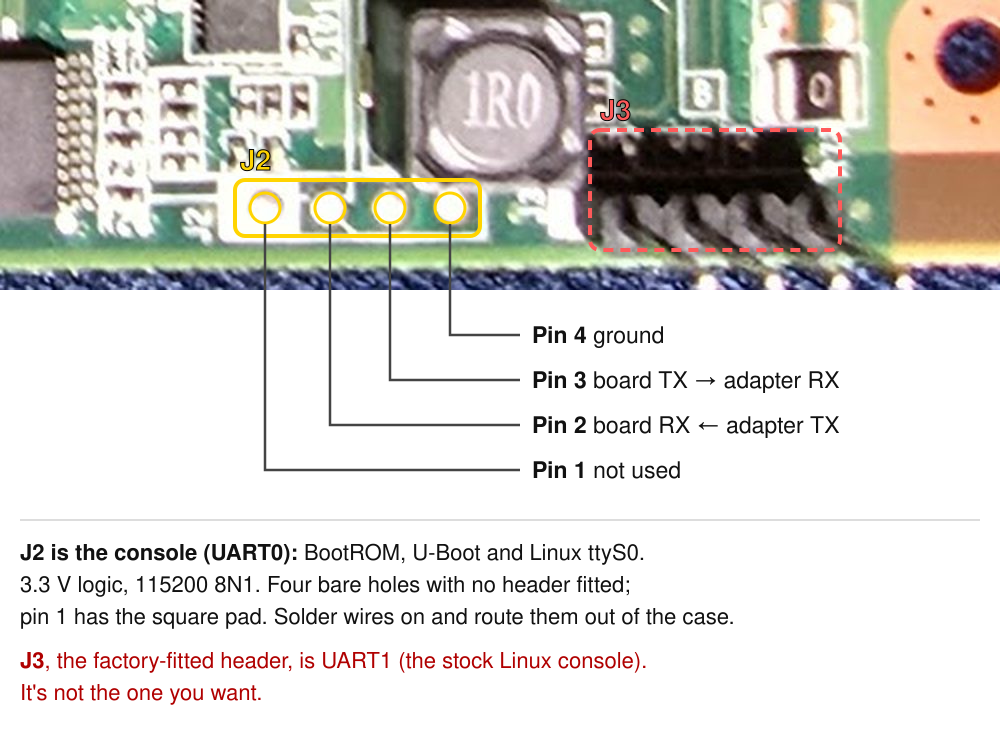
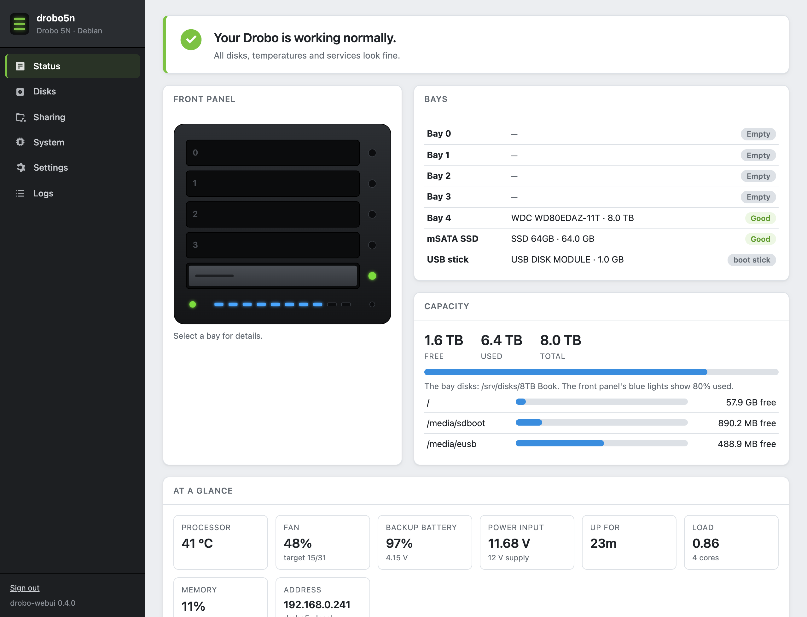

# Drobo 5N to Debian

> [!NOTE]
> **AI disclosure.** This project was done by George Stephanis working with Claude (Anthropic's **Claude Opus 5.5**, in Claude Code). Claude wrote most of the scripts, the boot stub and this guide, and ran commands on the Drobo over its serial console and SSH. George did the hardware side: opening the case, wiring the serial consoles and a Raspberry Pi Pico bridge, power-cycling and recovering the board, swapping fans, and checking results by eye and ear. He set the goals and constraints and reviewed what was published.
>
> Up to 11 November, the working sessions added up to roughly **13–14 hours over three days (9–11 November 2026)**, with George at the bench for nearly all of it (about 240 messages back and forth), plus hardware time of his outside the sessions. From the session logs, Claude produced about **1.15 million output tokens** over about 1,450 model calls, and took in about **3 million new input tokens**.[^cache] Those figures don't include the follow-up work from 12 November (Samba, the dashboard's later releases, HTTPS and the rescue button). Every step in this guide has run on real hardware: one Drobo 5N, across a few dozen boots, many of them failures along the way. The full log of what was tried, including the dead ends, is in the [project write-up](https://celestial-star.space.fast/).

How to replace Drobo OS on a Drobo 5N with plain Debian 13 that boots by itself, from the Drobo's own U-Boot, with no flashing of the bootloader. This is the short path. The long version, with every dead end, is in the [project write-up](https://celestial-star.space.fast/).

> [!TIP]
> **What you end up with.** Debian 13 (trixie, armhf, kernel `armmp-lpae`) on the Drobo's internal 1 GB eUSB stick. It boots by itself in about 2½ minutes (about 1 minute 20 with an mSATA SSD fitted), gets its address by DHCP, and answers SSH at `drobo5n.local`. All five bays work as ordinary SATA disks. The case fan follows the SoC and disk temperatures, and kernel updates rebuild the boot files on their own.

> [!WARNING]
> **Before you start.** This erases Drobo OS from the eUSB stick; step 5 makes a full backup first so you can go back. It doesn't touch the SPI flash (U-Boot) or the NOR flash. The only lasting changes outside the stick are a few U-Boot environment variables, listed in step 7 (and in section 9 for the optional SSD and rescue boot). You'll be opening the case and connecting a serial adapter. Keep a fan on the heatsink if the case is open. You do this at your own risk.

For what we learned about the hardware, U-Boot, the power controller and the stock firmware, see [`research/`](research/).

If you'd like an AI agent to help you through it, [`skills/drobo5n-debian/SKILL.md`](skills/drobo5n-debian/SKILL.md) is an Agent Skill for that: it covers what the agent can do and what needs your hands, how to drive this U-Boot's console without dropping characters, a checkpoint for each step, and the commands that hang or brick this board. For Claude Code, copy the folder to `~/.claude/skills/`.

## Steps

1. [What you need](#1-what-you-need)
2. [Get a console on U-Boot](#2-get-a-console-on-u-boot)
3. [Prepare the installer files](#3-prepare-the-installer-files-on-your-computer)
4. [Boot the Debian installer](#4-boot-the-debian-installer)
5. [Install Debian on the stick (and back it up)](#5-install-debian-on-the-stick-and-back-it-up)
6. [Run the Drobo kit inside the new system](#6-run-the-drobo-kit-inside-the-new-system)
7. [Make U-Boot boot Debian](#7-make-u-boot-boot-debian)
8. [First boot and everyday use](#8-first-boot-and-everyday-use)
9. [Optional extras](#9-optional-extras): root on an mSATA SSD, the rescue button, the web dashboard, file sharing
10. [Known limitations](#10-known-limitations)
11. [Troubleshooting](#11-troubleshooting)
12. [Going back to Drobo OS](#12-going-back-to-drobo-os)
13. [How it works](#13-how-it-works)

## 1. What you need

- A Drobo 5N (Marvell Armada XP MV78460, 2 GB RAM, internal eUSB stick).
- A **3.3 V** USB serial adapter (not 5 V) and jumper wires. 115200 baud, 8N1.
- A computer on the same wired LAN, with Python 3 and `dtc`/`fdtput` (macOS: `brew install dtc`; Debian/Ubuntu: `apt install device-tree-compiler`). A terminal program for the serial port (`screen`, `picocom`, `minicom`…).
- Two free IP addresses on that LAN for U-Boot to use during the network boot, and a DHCP server (your router) for Debian.
- The kit: the [`kit/`](kit/) folder of this repository.

| Kit file | Runs on | What it does |
|---|---|---|
| [`make-boot-files.py`](kit/make-boot-files.py) | your computer | Turns Debian's `vmlinuz`, an initrd and the device tree into the three files U-Boot loads |
| [`tftpd.py`](kit/tftpd.py) | your computer | A minimal read-only TFTP server, if you don't have one |
| [`drobo5n-base.dts`](kit/drobo5n-base.dts) | both | The board's device tree (no MAC in it; you add yours) |
| [`stub.bin`](kit/stub.bin) ([`stub.S`](kit/stub.S)) | U-Boot | A small trampoline that cleans up after U-Boot and enters the kernel. Build with `arm-none-eabi-gcc -march=armv7-a -marm -DCOPY -DIMG_LEN=0 -DDEST=0x01208000 -DDTB_ADDR=0x03f00000` |
| [`install-on-stick.sh`](kit/install-on-stick.sh) | the Drobo | Installs everything below and builds `/boot/drobo` |
| [`mkdrobokernel`](kit/mkdrobokernel), [`postinst-hook`](kit/postinst-hook), [`drobo-boot-ok`](kit/drobo-boot-ok.sh) | the Drobo | Rebuild the boot files whenever Debian installs a kernel or initrd, keeping the last set that booted in `prev`; restore `prev` if U-Boot had to fall back |
| [`uboot-fallback.txt`](kit/uboot-fallback.txt) | U-Boot | The boot command: power LED on, current set, `prev` on failure, one trial boot of a new set |
| [`uboot-ssd.txt`](kit/uboot-ssd.txt) | U-Boot | Optional, after `uboot-fallback.txt`: read the boot files from the mSATA SSD's ext2 partition when it's there (about 80 s faster) |
| [`uboot-rescue.txt`](kit/uboot-rescue.txt) | U-Boot | Optional, after `uboot-ssd.txt`: holding the pinhole button at power-on boots a rescue system from the stick |
| [`drobo-boot-sync`](kit/drobo-boot-sync) | the Drobo | Copies `/boot/drobo` to the SSD's `drobo-boot` partition after every change |
| [`drobo-powerbtn`](kit/drobo-powerbtn.sh), [`drobo-pmu-poweroff`](kit/drobo-pmu-poweroff.sh), [`drobo-watchdog.conf`](kit/drobo-watchdog.conf) | the Drobo | Power button → clean shutdown, `poweroff` cuts power, watchdog resets a hung system |
| [`mkdrobodtb`](kit/mkdrobodtb), [`drobo5n-fixups.dtsi`](kit/drobo5n-fixups.dtsi) | the Drobo | Device tree fixups: drive-bay expanders, mSATA power, unused Ethernet ports off |
| [`drobo-pmu.sh`](kit/drobo-pmu.sh), [`drobo-fand.sh`](kit/drobo-fand.sh), [`drobo-fan.service`](kit/drobo-fan.service) | the Drobo | Talk to the power-management chip; temperature-controlled fan |
| [`drobo-bays.sh`](kit/drobo-bays.sh), [`drobo-bays.service`](kit/drobo-bays.service), [`drobo-bays-watch.service`](kit/drobo-bays-watch.service) | the Drobo | Power the bays that hold a disk at boot, a few seconds apart, and later whenever a disk is inserted |
| [`initramfs-modules`](kit/initramfs-modules), [`initramfs-fsck-ext2`](kit/initramfs-fsck-ext2) | the Drobo | The USB, SATA and ext4 drivers the small initrd needs, and `fsck.ext2` for the rescue boot |

## 2. Get a console on U-Boot

1. Open the case. The console U-Boot uses is **J2** (UART0): four bare holes, under the RF shield, with no header fitted at the factory. Solder three wires to it (pin 2 = board RX, pin 3 = board TX, pin 4 = ground; 3.3 V logic) and route them out through the case, so you don't need to open it again. You'll need to cut a small hole in the RF shield to reach it. The factory-fitted 4-pin header **J3** is a different UART: the stock Linux console, not this one.

   
2. Wire it: header pin 2 is the board's RX (to your adapter's TX), pin 3 is the board's TX (to your adapter's RX), pin 4 is ground. Add a separate ground wire to the board if your input seems to be ignored. A bad ground crimp gives a console that prints fine but ignores input.
3. Open the port at 115200 8N1 and power the Drobo on.
4. The stock `bootdelay` is 0, so **tap the space bar continuously from the moment you press power** until you see the `Marvell>>` prompt. Then type slowly or paste in short pieces. This U-Boot drops characters if you send them too fast.
5. Save a copy of the environment by copying the output of `printenv` into a file. Note `ethaddr`, the board's MAC address; you'll need it. Then give yourself time to stop it in future:

   ```
   setenv bootdelay 3
   saveenv
   ```

> [!NOTE]
> Don't run `flinfo`: it crashes this U-Boot. Avoid `bootm` for Linux too: this Drobo build can't start a modern kernel that way. Everything here uses `go`.

## 3. Prepare the installer files (on your computer)

```sh
git clone https://github.com/georgestephanis/drobo-5n.git
cd drobo-5n
B=https://deb.debian.org/debian/dists/trixie/main/installer-armhf/current/images
curl -LO $B/netboot/vmlinuz -LO $B/netboot/initrd.gz -LO $B/SHA256SUMS
grep -E ' \./netboot/(vmlinuz|initrd.gz)$' SHA256SUMS        # compare with:
shasum -a 256 vmlinuz initrd.gz
```

Put your MAC into the device tree, so Debian always gets the same DHCP lease. In `kit/drobo5n-base.dts`, replace the comment under `ethernet@70000 {` with a line like this, using your `ethaddr`:

```
local-mac-address = [00 1a 62 12 34 56];
```

Then build the boot files and serve them over TFTP:

```sh
python3 kit/make-boot-files.py vmlinuz initrd.gz kit/drobo5n-base.dts
# writes out/kernel.bin, out/initrd, out/drobo5n.dtb
python3 kit/tftpd.py --root out --bind 0.0.0.0     # UDP port 69; keep it running
```

On macOS use Apple's `/usr/bin/python3` for the TFTP server. Local Network privacy can block other Pythons from reaching the LAN.

## 4. Boot the Debian installer

At the `Marvell>>` prompt, set an address for U-Boot and your computer's address as the server. These live in RAM only; don't `saveenv` here. Then load the three files and jump:

```
setenv ipaddr 192.168.1.99
setenv serverip 192.168.1.50
setenv netmask 255.255.255.0
tftpboot 3f00000 drobo5n.dtb
tftpboot 4000000 initrd
tftpboot 8000000 kernel.bin
usb stop
go 8000000
```

The stub prints a few register lines, then the kernel boots, and the installer's "Select a language" screen appears on the serial console within seconds.

> [!NOTE]
> Those addresses must stay as they are: `3f00000` for the DTB, `4000000` for the initrd, `8000000` for the kernel. `usb stop` before `go` matters; without it the USB controller keeps writing into memory under Linux's feet.

## 5. Install Debian on the stick (and back it up)

Go through the installer as usual, over the serial console. Pick the network interface `eth0` and let it use DHCP. Notes for each step:

- **Users:** `admin` is a reserved name in Debian; pick another. You can leave root locked.
- **Back up the stick before partitioning.** When you reach "Partition disks", switch to a shell. The installer runs in `screen` on the serial console, so press `Ctrl-A` then `2`, or choose "Execute a shell" from the main menu. The stick is `/dev/sda` (about 981 MB). On your computer run `nc -l 9000 > eusb-drobo-os.img` (some systems need `nc -l -p 9000`). Then, in the installer shell:

  ```sh
  dd if=/dev/sda bs=1M | nc 192.168.1.50 9000
  ```

  Check that the image is the stick's full size before going on. Keep it: it's your way back to Drobo OS.
- **Partitioning:** guided partitioning says the stick is too small, so use manual. Create **one partition over the whole stick, ext2, mounted at `/`, no swap**. ext2 suits the small flash stick. It has to be `/dev/sda1`, because that's what the device tree's command line expects.
- **Software selection:** tick **only "SSH server"**. Untick "standard system utilities" and any desktop. The stick is only 1 GB.
- **Boot loader:** there's nothing to install. Choose "Continue without boot loader" and dismiss the warning.
- **Stop before the final reboot.** At "Finish the installation", don't continue yet. Go to step 6 first.

## 6. Run the Drobo kit inside the new system

Still in the installer's shell (`Ctrl-A 2`), with the installed system at `/target`. The installer has no `git`, so fetch the kit as a tarball; it unpacks to `kit/`:

```sh
cd /target/root
wget http://drobo5n-debian.view.homefast.stephanis.me/drobo5n-kit.tar.gz
tar xzf drobo5n-kit.tar.gz
chroot /target sh /root/kit/install-on-stick.sh 00:1a:62:12:34:56     # your ethaddr
```

That tarball holds the same files as `kit/` here. If you'd rather not download it, serve this repository's `kit/` folder from your computer (`python3 -m http.server 8000` in the repo) and `wget` each file from there into `/target/root/kit/`.

If `apt-get` fails inside the chroot, mount the system directories first: `for d in dev proc sys; do mount --bind /$d /target/$d; done`, and copy `/etc/resolv.conf` into `/target/etc/`.

It takes a few minutes. It installs `u-boot-tools`, `device-tree-compiler`, `xz-utils`, `gpiod`, `busybox` (its `i2cget`/`i2cset` avoid `i2c-tools`, which pulls in Perl), `hdparm`, `openssh-server` and `avahi-daemon`, and copies the tools in. It builds the device tree with your MAC, shrinks the initrd to about 10 MB (`MODULES=dep` plus the USB, SATA and ext4 drivers), and writes the boot files to `/boot/drobo`. It ends by listing them:

```
drobo5n.dtb  initrd  kernel.0  kernel.1  kernel.2  kernel.3  kernel.4  SETID  VERSION  prev/
```

Then go back to the installer (`Ctrl-A 1`) and let it finish and reboot. Be ready to tap space again to catch U-Boot.

> [!NOTE]
> Running the kit from the installer's chroot is the shortcut. On the test board, the same script ran on the installed system, and that boot set boots. If the chroot gives you trouble, finish the install, then boot the installed system once over TFTP: copy `/boot/vmlinuz-*` and `/boot/initrd.img-*` off the stick, and use `make-boot-files.py` with them. Then run `sudo sh install-on-stick.sh <MAC>` there.

## 7. Make U-Boot boot Debian

At the `Marvell>>` prompt, type these one line at a time:

```
setenv bootcmd_stock amp_boot
setenv amp_enable no
setenv autostart no
setenv dbusb usb start
setenv dbstop usb stop
setenv dbgo go 8000000
setenv dbdtb ext2load usb 0:1 3f00000 /boot/drobo/drobo5n.dtb
setenv dbini ext2load usb 0:1 4000000 /boot/drobo/initrd
setenv dbk0 ext2load usb 0:1 b000000 /boot/drobo/kernel.0
setenv dbk1 ext2load usb 0:1 b800000 /boot/drobo/kernel.1
setenv dbk2 ext2load usb 0:1 c000000 /boot/drobo/kernel.2
setenv dbk3 ext2load usb 0:1 c800000 /boot/drobo/kernel.3
setenv dbk4 ext2load usb 0:1 d000000 /boot/drobo/kernel.4
setenv dbu0 bootm b000000
setenv dbu1 bootm b800000
setenv dbu2 bootm c000000
setenv dbu3 bootm c800000
setenv dbu4 bootm d000000
setenv dbpdtb ext2load usb 0:1 3f00000 /boot/drobo/prev/drobo5n.dtb
setenv dbpini ext2load usb 0:1 4000000 /boot/drobo/prev/initrd
setenv dbpk0 ext2load usb 0:1 b000000 /boot/drobo/prev/kernel.0
setenv dbpk1 ext2load usb 0:1 b800000 /boot/drobo/prev/kernel.1
setenv dbpk2 ext2load usb 0:1 c000000 /boot/drobo/prev/kernel.2
setenv dbpk3 ext2load usb 0:1 c800000 /boot/drobo/prev/kernel.3
setenv dbpk4 ext2load usb 0:1 d000000 /boot/drobo/prev/kernel.4
setenv dbcur 'run dbdtb dbini dbk0 dbk1 dbk2 dbk3 dbk4 dbu0 dbu1 dbu2 dbu3 dbu4'
setenv dbprv 'echo DROBO: booting prev; run dbpdtb dbpini dbpk0 dbpk1 dbpk2 dbpk3 dbpk4 dbu0 dbu1 dbu2 dbu3 dbu4'
setenv dbboot 'run dbstop dbgo'
setenv dbnorm 'run dbcur dbboot || run dbprv dbboot'
setenv dbtrial 'if test "x$dbtry" = "x$dbtrialid"; then echo DROBO: trial $dbtrialid failed; run dbprv dbboot; else echo DROBO: trial boot $dbtrialid; setenv dbtry $dbtrialid; saveenv; run dbcur dbboot || run dbprv dbboot; fi'
setenv dbled 'gpio s 28; gpio s 35'
setenv dbsel 'run dbled; setenv dbtrialid; run dbusb; if ext2load usb 0:1 1000000 /boot/drobo/trial; then source 1000000; run dbtrial; else run dbnorm; fi'
setenv bootcmd 'run dbsel'
printenv bootcmd amp_enable
saveenv
reset
```

> [!WARNING]
> **`amp_enable no` is essential.** With it set to `yes` (the stock value), Marvell's start-up code puts `bootcmd=amp_boot` back on every boot, whatever you saved. `amp_boot` then looks for vxWorks, doesn't find it, and hangs the board, and the power button may not get it out of that. Before trusting the change, catch U-Boot after the `reset` and check that `printenv bootcmd` still shows your line.

The second half of that list (also in [`kit/uboot-fallback.txt`](kit/uboot-fallback.txt)) is the fallback. `dbsel` lights the power LED yellow, then boots the current set in `/boot/drobo`. If any file fails to load, it boots `/boot/drobo/prev` instead. When `mkdrobokernel` installs a new set, it leaves a flag file, `/boot/drobo/trial`, a tiny U-Boot script that sets `dbtrialid`. U-Boot saves `dbtry=<that id>` and tries the new set once. If the flag is still there on the next boot, that try didn't come up (with `panic=10` a failed boot resets the board), so U-Boot boots `prev`. Paste the lines exactly: this U-Boot's `test` drops empty quoted strings, which is why the comparisons use `"x$dbtry"`.

From now on the Drobo boots Debian by itself. U-Boot reads about 20 MB from the stick (around 80 seconds; it's slow), unpacks the kernel pieces, and jumps. Debian is on SSH about 2½ minutes after power-on. With an mSATA SSD set up as in section 9, U-Boot reads the same files over SATA in about a second, and SSH is up in about 80 seconds.

## 8. First boot and everyday use

```sh
ssh you@drobo5n.local
systemctl --failed                       # should be empty
sudo drobo-bays status                   # disk present / powered, per bay
sudo journalctl -u drobo-fan -b          # "fan target 16" etc.
cat /sys/class/hwmon/hwmon*/temp1_input  # SoC (and disk) temperatures, millidegrees
```

- **Drive bays.** Bays are numbered 0 (top) to 4 (bottom). At boot, `drobo-bays` powers every bay that holds a disk, 4 s apart. The disks then appear as ordinary SATA disks (`/dev/sdb`…). Use them with whatever you like: ext4, mdadm, mergerfs and SnapRAID, or OpenMediaVault. Drobo's BeyondRAID disk packs are not readable. After boot, `drobo-bays-watch` powers a bay within a couple of seconds of a disk going in, and switches it off when the disk comes out (tested 12 Nov with an 8 TB disk in bay 4: Linux saw it about 15 s later, at 6 Gbps). It only acts on a change, so a bay you switched off stays off. `sudo drobo-bays on` powers every bay that holds a disk; `off` powers all bays down.
- **Fan.** `drobo-fand` sets the speed (01–31) from the hottest sensor, resent every 30 s. The power controller winds the speed down by itself if nobody keeps setting it. It never goes below 16, because the stock fan's bearing can stall at low speed. Tune it in `/etc/default/drobo-fan`, for example `FLOOR=12 SOC_HI=70`. If the fan doesn't start after a cold boot, give it a nudge, or replace it.
- **Kernel updates.** Nothing to do by hand: `apt upgrade` works as usual.
  - When apt installs a kernel or rebuilds an initrd, a hook runs `mkdrobokernel`, which rebuilds `/boot/drobo`. Debian runs it twice per install; that's expected. It refuses to build with less than 50 MB free.
  - Each set's DTB carries an id (`/chosen/drobo,set-id`), the root by UUID, `panic=10` and `fsck.repair=yes`.
  - The next boot of a new set is a **trial**. A minute after boot, `drobo-boot-ok` checks which set came up. If it was the new one, it records it as good. Only a set that has booted is ever moved into `prev`.
  - If the trial didn't come up, U-Boot boots `prev` instead, and `drobo-boot-ok` moves the broken set to `/boot/drobo/failed`, puts `prev` back as current, and logs a warning (`journalctl -u drobo-boot-ok`).
  - Tested: a set with a wrong root UUID panicked, reset, and came back on `prev` with nobody at the console (11 Nov); a real `apt-get install --reinstall` of the kernel went through both hook runs and its trial boot (12 Nov).
- **Watchdog.** systemd keeps the SoC watchdog running (`RuntimeWatchdogSec=60s`, from `drobo-watchdog.conf`). If the system hangs for a minute, the board resets. A watchdog reset was tested and comes back through U-Boot as normal.
- **Power button.** A short press on the back does a clean shutdown: the power LED turns red, Linux shuts down, and the power goes off. `drobo-powerbtn` sends the power controller "CPU is up" (`K`) at boot and runs `poweroff` when it raises the power-down request (SoC GPIO 40). `sudo poweroff` also really powers off: the last shutdown step sends the controller `S`. Press the button again to power on. A power cut does the same thing: the backup battery holds the board up long enough for a clean shutdown (3.5 s measured), and the journal says "power failed, running on battery" instead of "power button pressed".

## 9. Optional extras

None of these is needed to run the box. Moving the root to an mSATA SSD is the one worth doing first: it makes the boot twice as fast and spares the stick, and the rescue button builds on it.

### Root and boot files on the mSATA SSD (recommended)

The 1 GB stick is tight, wears out, and is slow: U-Boot needs about 80 s to read 20 MB from it. U-Boot can read the SSD over SATA in about a second, but its ext2 driver can't read ext4 (it **hangs** on an ext4 partition), so the SSD gets two partitions: ext4 for root, and a small ext2 `drobo-boot` partition at the end that holds a copy of `/boot/drobo`. The stick keeps the master copy at `/boot` and stays the fallback: U-Boot uses the stick whenever the SSD's copy is missing. The old root stays on the stick too, and becomes the rescue system below. With an SSD in the slot (power off first; it shows up as `sda`, and the stick moves to `sdb`):

```sh
lsblk                                                               # make sure sda is the SSD
SZ=$(( $(sudo blockdev --getsz /dev/sda) - 2048 - 2097152 - 4096 ))     # all but ~1 GiB, in sectors
printf 'label: gpt\n,%s,L,\n,,L,\n' $SZ | sudo sfdisk /dev/sda   # root, then a 1 GiB boot partition at the end
sudo mkfs.ext4 -L drobo-root /dev/sda1
sudo mkfs.ext2 -b 4096 -I 256 -L drobo-boot /dev/sda2               # plain ext2, the only thing U-Boot reads
sudo mkdir -p /mnt/newroot && sudo mount /dev/sda1 /mnt/newroot
sudo sh -c 'tar -C / --one-file-system --xattrs --acls -cpf - . | tar -C /mnt/newroot --xattrs --acls -xpf -'
sudo mv /mnt/newroot/boot /mnt/newroot/boot.copy-from-stick && sudo mkdir /mnt/newroot/boot /mnt/newroot/media/eusb /mnt/newroot/media/sdboot
NEW=$(sudo blkid -s UUID -o value /dev/sda1); STICK=$(findmnt -no UUID /)
printf '%s\n' "UUID=$NEW / ext4 noatime,errors=remount-ro 0 1" "UUID=$STICK /media/eusb ext2 noatime 0 2" \
  "/media/eusb/boot /boot none bind 0 0" "LABEL=drobo-boot /media/sdboot ext2 noatime,nofail 0 2" | sudo tee /mnt/newroot/etc/fstab
sudo umount /mnt/newroot
sudo ROOT_UUID=$NEW ROOT_FSTYPE=ext4 mkdrobokernel                   # a trial set with root on the SSD; also copies it to sda2
sudo reboot
```

Then have U-Boot read the boot files from the SSD:

1. At the U-Boot prompt, first check that `md.l d0018180 2` reads `1` and `6`. Then type the lines in [`kit/uboot-ssd.txt`](kit/uboot-ssd.txt) and `saveenv`.
2. Reboot and check: `findmnt /` shows `/dev/sda1`, `findmnt /boot` shows `/dev/sdb1[/boot]`, and the console prints `DROBO: boot files from the SSD`.

> [!CAUTION]
> Never point `ext2load` or `ext2ls` at the ext4 root partition (`ide 1:1`). This U-Boot hangs until the power is cut.

How it works: `drobo-boot-sync`, run by `mkdrobokernel` and `drobo-boot-ok`, keeps the SSD's copy in step with the stick. It builds the new copy beside the old one and swaps it in with two renames, so U-Boot only ever sees a complete set or none. The U-Boot lines switch on the mSATA power (SoC GPIO 66; `gpio s 66` doesn't make it an output, so they write GPIO bank 2's output and output-enable registers directly, `0xd0018180` = 5 and `0xd0018184` = 2), run `ide reset`, and load from `ide 1:2` if `/boot/drobo/VERSION` is there, otherwise from the stick. If no set on the SSD loads, they try the stick.

Tested on 11 Nov with a 64 GB mSATA SSD: reboot to SSH went from 154 s to 79 s. Hiding the SSD's copy made it fall back to the stick (157 s), and the next `drobo-boot-ok` rebuilt the copy.

If you stay on the stick instead: no swap, `noatime` (the installer's default), and consider `Storage=volatile` in `/etc/systemd/journald.conf`.

### Rescue system (pinhole button)

A rescue boot for when the normal system won't come up. It boots the old Debian root on the internal stick, and reads nothing from the SSD, so a broken SSD root, a bad config or a bad kernel can't get in the way.

**To use it:** hold the small button in the hole beside the power socket with a straightened paper clip, press the power button, and keep holding until the power light turns **red**. That takes 15–20 s; the light is yellow for a moment first. About 2½ minutes later it's on SSH at the usual name, and the login banner says it's the rescue system. Mount the SSD root from there to repair it, then reboot without the button.

**To set it up** (once the root is on the SSD):

1. On an install from before 12 Nov only, add the fsck hook from the kit. The initrd only carries the checker for the main root's type (ext4), and without this the rescue boot can't check the stick's ext2 root:
   ```sh
   sudo install -m 755 initramfs-fsck-ext2 /etc/initramfs-tools/hooks/drobo-fsck-ext2
   sudo update-initramfs -u
   ```
2. Build the rescue set. It goes in `/boot/drobo/rescue`, with root on the stick:
   ```sh
   sudo mkdrobokernel --rescue
   ```
3. At the U-Boot prompt, type the lines in [`kit/uboot-rescue.txt`](kit/uboot-rescue.txt). They end with `saveenv`.

How it works:
- The button is SoC GPIO 65, active-low. This U-Boot has no `setexpr`, and `gpio r` always succeeds, so `dbbtn` reads GPIO bank 2's input register (`0xd0018190`) with `itest`. It reads 3 at rest; any value with bit 1 clear (0, 1, 4 or 5) means pressed.
- The rescue set is built from the kernel the stick root has modules for, and kernel updates never replace it. Its command line adds `drobo.rescue=1`.
- In the rescue system, `mkdrobokernel` refuses to rebuild the main set (it would point it at the stick), and `drobo-boot-ok` doesn't recognise the rescue set's id, so it changes nothing.
- If the rescue files don't load, the normal boot carries on.

Tested on 12 Nov: holding the button from a cold power-on booted the rescue system, stock U-Boot did nothing else with the button (no recovery, no update), and a normal boot afterwards still came from the SSD.

### Web dashboard

[`webui/`](webui/) is a separate package, `drobo-webui`, with a browser dashboard in the spirit of Drobo Dashboard. It covers bays and the front panel, capacity, SMART, temperatures and the fan, network and services, logs, and e-mail alerts. Its Sharing page puts each bay disk on the network as its own share, with per-person access (see File sharing below). It also has settings for the device name, the fan curve, bay power, HTTPS with a self-signed certificate, disk sleep, the SMART self-test schedule, software updates, and restart or shut down. It takes about 25 MB with lighttpd and PHP, and nothing else in the kit needs it, so skip it on a stick-only install. Download it from [the webui-v0.4.0 release](https://github.com/georgestephanis/drobo-5n/releases/tag/webui-v0.4.0), and see [`webui/README.md`](webui/README.md).



### File sharing (SMB)

The easy way is the dashboard's **Sharing** page: install Samba (the first command below), turn sharing on, add a person, and every disk you put in a bay is shared as its own folder, read-only until you allow changes. Access is per person, either all disks or chosen ones, and is remembered when a disk is pulled and put back. It was tested on 12 Nov with an exFAT disk from a WD My Book: it was mounted and shared seconds after the bay powered on, a Mac saw it in Finder, writes were refused while it was read-only, and "Safely remove" followed by powering the bay back on shared it again on its own.

To set Samba up by hand instead: Samba works as on any Debian box. [`kit/smb.conf`](kit/smb.conf) is a starting point: SMB2 and newer only, no guest access, the macOS `fruit` options, and one share, `Drobo`, at `/srv/drobo`. Point `path` at your bay disks once they're mounted. `wsdd2` makes the Drobo show up under Network in Windows; macOS finds it through Avahi, which Debian already runs.

```sh
sudo apt install --no-install-recommends samba wsdd2       # about 75 MB
sudo cp /etc/samba/smb.conf /etc/samba/smb.conf.debian-orig
sudo cp smb.conf /etc/samba/smb.conf && testparm -s
sudo install -d -o $USER -g $USER -m 775 /srv/drobo
sudo smbpasswd -a $USER                                    # a separate password, just for SMB
sudo systemctl restart smbd nmbd
```

Then connect from a Mac with `smb://drobo5n.local/Drobo`. Tested on 11 Nov from macOS: it showed up in Finder by itself, negotiated SMB 3.1.1 with signing, and writing, renaming and moving files all worked.

## 10. Known limitations

- **Without `drobo-powerbtn` running** (for example in the installer, or before the service starts), the power controller treats a press of the power button as "nothing is running" and cuts power at once, with no shutdown.
- **The first 16 MB of RAM** are left unused, because writes below 16 MB hang this board early in boot. That leaves 1.98 GB visible.
- **Hardware crypto (CESA) is off.** Its hash self-tests fail on Debian's 6.12 kernel, so it's blacklisted; the kernel uses software crypto instead.
- **Boot from the stick is slow**, about 2½ minutes, almost all of it U-Boot reading the stick over USB. With the mSATA boot partition it's about 80 seconds.
- **The mSATA slot** is powered from boot (SoC GPIO 66, held high by the device tree). It's the SoC's second SATA port, `ata2`: a 64 GB mSATA SSD came up there at 3 Gbps on 11 Nov and took `sda`, which is why root is found by UUID. It isn't hot-swap: power off first.

## 11. Troubleshooting

| Symptom | Cause and fix |
|---|---|
| U-Boot runs `amp_boot` / "Checking for vxWorks" and hangs | `amp_enable` is still `yes`. Unplug the power for 10 s, catch U-Boot, and redo step 7. |
| Typing at `Marvell>>` does nothing | The ground wire, a loose connection on J2, or TX/RX swapped. Output working only means RX is fine. |
| Nothing after `go 8000000` | Make sure you ran `usb stop` first, and that the initrd ends below `0x8000000` (`make-boot-files.py` checks this). |
| `inflate() returned -5` | A kernel piece is too big for this U-Boot's 8 MB unpack limit. `mkdrobokernel` splits at 7 MiB, so rerun it. |
| Boots, but can't find root | The DTB names root by UUID (`fdtget /boot/drobo/drobo5n.dtb /chosen bootargs`); rerun `mkdrobokernel` after changing the root filesystem. Or, from a TFTP boot of the installer, chroot and set `MODULES=most` in `/etc/initramfs-tools/initramfs.conf`, then `update-initramfs -u`. |
| A different IP every boot | The MAC isn't in the DTB. Check with `fdtget /usr/local/lib/drobo/drobo5n-base.dtb /soc/internal-regs/ethernet@70000 local-mac-address`. |
| Need the old kernel | In U-Boot, `run dbusb dbprv dbboot` boots `/boot/drobo/prev` once (with the SSD lines from section 9: `run dbpick dbprv dbboot`). A new set that fails to boot falls back to it by itself. |
| The normal system won't come up | Hold the pinhole button at power-on for the rescue system (section 9), or at the U-Boot prompt `run dbresc`. |
| Power LED stays red, board stays on after `poweroff` | The shutdown hook couldn't reach the power controller. Check `/usr/lib/systemd/system-shutdown/drobo-pmu-poweroff` exists, and hold the button for 6 s. |

## 12. Going back to Drobo OS

1. Boot the installer once more over TFTP (step 4), open a shell, and write your backup back: `nc -l -p 9000 | dd of=/dev/sda bs=1M` in the installer, then `nc <drobo-ip> 9000 < eusb-drobo-os.img` on your computer. Run `sync` before rebooting.
2. In U-Boot: `setenv amp_enable yes`, `setenv bootcmd amp_boot`, `saveenv`, `reset`.

## 13. How it works

For the curious. The details are in the [write-up](https://celestial-star.space.fast/).

- The Drobo's U-Boot (2009.08, Marvell's AMP build) normally boots vxWorks on one core. It can't start a modern kernel with `bootm`, so we use `go` on a small stub. The stub flushes and turns off the caches and MMU, holds the other cores in reset, stops the USB controller, copies the uncompressed kernel to `0x1208000`, and enters it with the DTB pointer in `r2`.
- Debian's multi-platform kernel expects to sit at RAM + `0x208000`. Copying it 16 MB higher works around the board hanging on writes below 16 MB.
- U-Boot's `bootm` is still used, but only as a gzip unpacker. The 26 MB kernel is cut into 7 MiB pieces, each wrapped as a gzip "standalone" image with `autostart=no`. That keeps each piece under this U-Boot's 8 MB unpack limit, and it cuts what U-Boot has to read from the slow stick from 27 MB to about 9 MB.
- The device tree is mainline's `armada-xp-db` (the reference board this U-Boot believes it is). The internal registers are moved to `0xd0000000`, where this U-Boot leaves them. Flash, SD and NAND are off, and only the two PCIe ports that are wired (`pcie@8,0`, `pcie@9,0`, a Marvell 88SE9122 SATA controller each) are on. The fixups add the backplane's two PCA9555 I²C expanders (0x20 for bay LEDs; 0x23 for bay power and the active-low detect lines), hold the mSATA power line on, and drop three Ethernet ports the Drobo doesn't have.
- The fan and power live on a separate controller reached through the SoC's third UART (`ttyS2`, 38400 baud), with ASCII commands such as `FT31` (fan target), `FA.` (actual) and `V` (version).

---

November 2026 · written by George Stephanis with Claude. Tested on one Drobo 5N: every step has run on that board, and the kit's `install-on-stick.sh` was run on its installed system and booted. The whole sequence has not yet been repeated on a second, fresh Drobo, so corrections and issues are welcome.

## License

GPL-2.0, the same as the Linux kernel and U-Boot. See [LICENSE](LICENSE). `kit/drobo5n-base.dts` is derived from the mainline kernel's Armada XP device trees, which are GPL-2.0 or MIT.

[^cache]: Not counted above: each model call also re-reads the conversation so far from the prompt cache, which adds up to about 317 million cached input tokens. Those are cheap re-reads of the same context, not new work.
