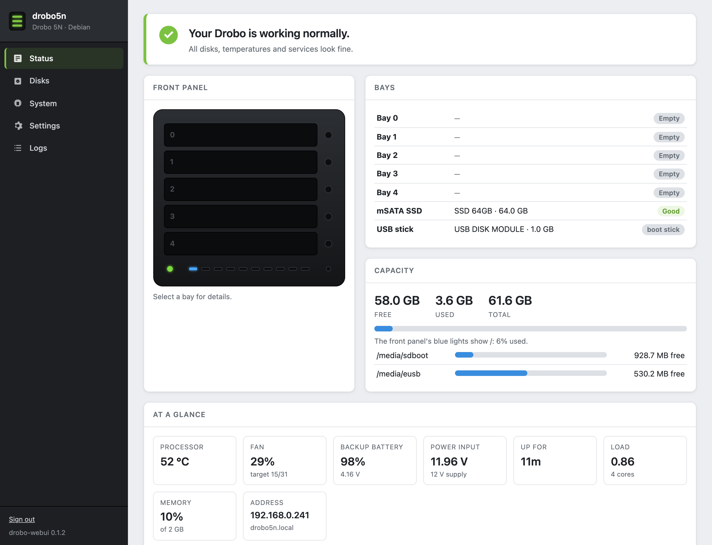
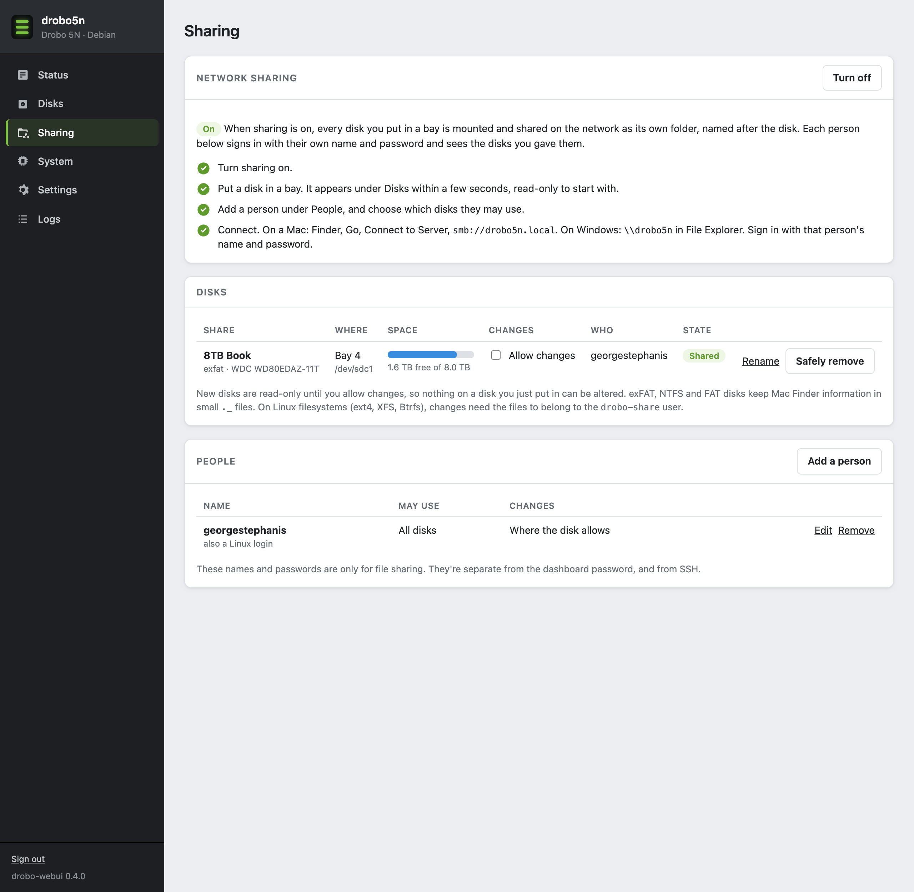

# drobo-webui: an optional web dashboard

A small web dashboard for a Drobo 5N running Debian with this kit, in the spirit of the old Drobo Dashboard: the front panel with its lights, how full the storage is, the disks and their SMART health, temperatures and the fan, and a few settings. It's **optional**. The kit boots, shares and runs fine without it, and everything it shows is also available over SSH. It just makes the box friendlier.

It needs about 25 MB with its dependencies (lighttpd, PHP). On a system running from the 1 GB internal USB stick, you can simply skip it.



| | |
|---|---|
|  |  |
|  |  |
|  |  |
|  | |


## What it does

- **Status:** a picture of the front panel whose bay, power and blue capacity lights follow the same rules as `drobo-leds`. It also shows a list of bays plus the mSATA and USB disks, capacity (the bay disks, as on the front panel, with the internal SSD and stick listed separately), and a status line ("Your Drobo is working normally" or what's wrong). Select a bay for its disk's details, or to power the bay on or off.
- **Disks:** every disk by slot (bay 0–4, mSATA, USB stick) with model, size, temperature, SMART health, hours powered on and bad-sector counts. It also lists filesystems and any Linux RAID (md) arrays. Sleeping disks aren't woken to read SMART.
- **Sharing:** bay disks on the network, one Samba share per disk. Needs Samba (`sudo apt install --no-install-recommends samba wsdd2`).
  - **On or off** for the whole feature, with a four-step checklist and how to connect from a Mac or Windows.
  - **Disks:** every disk it has seen, by filesystem UUID, so a disk keeps its settings when it's pulled and put back. A disk put in a bay is mounted at `/srv/disks/NAME` (named after its label) within seconds and shared. New disks are **read-only** until you tick "Allow changes"; a read-only mount doesn't even replay a journal, so nothing on the disk is written. "Safely remove" unmounts it, detaches it from Linux and switches its bay off (the bay light turns yellow). A disk that's in a bay but not mounted gets a **Mount** button, and one that was safely removed but left in its bay gets **Turn on**. Also Rename, and Forget for a disk that's gone. Disks it can't share (no filesystem, a BeyondRAID pack, something listed in `/etc/fstab`) are listed with the reason.
  - **People:** Samba accounts. Each gets a name and password and either all disks (including future ones) or a ticked list of disks, and can be made read-only. A new name gets a Linux account that can't log in; an existing Linux login (like the one from the install) just gets a sharing password.
  - Supported filesystems: ext2/3/4, XFS, Btrfs, F2FS, exFAT, FAT and NTFS (the kernel's `ntfs3`). exFAT, FAT and NTFS disks are owned by the `drobo-share` user through mount options, and Macs keep their Finder information in `._` files on them. On Linux filesystems, writes need the files to belong to `drobo-share`.
- **System:** OS, kernel and boot files, whether the boot copy on the SSD is in place, load, memory, processor temperature, fan level from the PMU, network, and the state of the kit's services.
- **Power:** the 12 V input voltage and the backup battery (a single 18650 cell) as read by the PMU, with a rough charge level. If the power fails, the PMU signals Linux and the battery carries the box through a clean shutdown; the dashboard shows when it's running on battery.
- **Settings:**
  - Device name (`NAME.local`).
  - Date and time: time zone, network time on or off, your own time servers, and setting the clock by hand when network time is off.
  - Fan curve (`/etc/default/drobo-fan`).
  - E-mail alerts through any SMTP server (STARTTLS, SSL or plain), with a test button.
  - Temperature unit, refresh rate, and an option to let anyone on the network see the status pages without signing in.
  - Dashboard password.
  - Disk sleep: spin the bay disks down after 10 minutes to 2 hours idle (a udev rule that runs `hdparm -S`, so it also covers disks inserted later).
  - SMART self-tests: off, a short test every Sunday, or that plus a long test on the 1st of the month (the `-s` schedule on smartd's `DEVICESCAN` line in `/etc/smartd.conf`, which keeps a `.bak`).
  - Software updates: how many updates are waiting and which are security fixes, "Check now" (`apt-get update`), and "Install updates" (`apt-get upgrade`, keeping your config files). Both run in the background as `drobo-webui-apt`, and the card shows the output. It says when a new kernel needs a restart.
  - HTTPS: whether this page is encrypted, the certificate's names, dates and SHA-256 fingerprint, a download button, and "Make a new one".
  - Restart and shut down.
- **Logs:** the journal for the kit's services, SSH, Samba and the kernel.
- **Alerts:** a timer runs every 5 minutes and mails a problem once when it starts and once when it clears. It covers a failing SMART check, bad sectors, hot disks or processor, a full filesystem, a degraded RAID array, a failed bay, failed services, a low backup battery, a sagging power input, and running on battery.
  A disk that won't mount, or that has reallocated, pending or uncorrectable sectors, gets its bay light solid red (`/run/drobo-leds/attention-bays`), and the bay's page says why. A disk that fails its SMART health check also gets its bay light blinking red: the check writes the bay to `/run/drobo-leds/failed-bays`. It only adds and removes the bays it marked itself, so a bay you list there by hand stays.

## Install

Download the package from the [releases page](https://github.com/georgestephanis/drobo-5n/releases/tag/webui-v0.4.3), or build it yourself (see [Building](#building)). Then, on the Drobo with the kit already installed:

```sh
wget https://github.com/georgestephanis/drobo-5n/releases/download/webui-v0.4.3/drobo-webui_0.4.3_all.deb
sudo apt install ./drobo-webui_0.4.3_all.deb
sudo drobo-webui-passwd          # set the dashboard password
```

Then open `https://drobo5n.local/` (or the device's name or IP address). The certificate is self-signed, so the browser warns the first time; Settings > HTTPS shows its SHA-256 fingerprint to compare and offers it for download, so you can trust it on your computer (on a Mac: Keychain Access, Always Trust). Plain `http://` still works.

To remove it: `sudo apt remove drobo-webui` (add `--purge` to delete its settings too). Nothing else in the kit depends on it. Afterwards, `apt autoremove` offers to remove lighttpd and PHP; dry-run it first (`apt-get -s autoremove`) to check that it lists only those.

## How it's built

- **Web server:** its own lighttpd instance (`drobo-webui.service`, config `/etc/drobo-webui/lighttpd.conf`) on port 80 (HTTP) and 443 (HTTPS), with PHP through FastCGI. Both run as `www-data`. Installing it disables Debian's own `lighttpd.service`. To use other ports, change `server.port` and the `:443` sockets there.
- **HTTPS:** a self-signed certificate (P-256, 825 days, the longest Apple accepts) in `/etc/drobo-webui/tls/`; only root can read the key. `drobo-webui-cert ensure` runs before each start of the service and makes a new one when it's missing, within 30 days of expiry, or doesn't name the current device name, so changing the name in Settings restarts the dashboard with a new certificate. Settings can also make a new one on request; the previous pair is kept as `*.old`. TLS 1.2 is the minimum.
- **PHP** (`/usr/share/drobo-webui/`):
  - `public/api.php` is a small JSON API.
  - `lib/` reads everything that needs no special rights straight from `/proc`, `/sys` and `systemctl`.
  - Bay, slot and LED rules match `research/backplane-and-bays.md` and `kit/drobo-leds.sh`. Slots are found by SATA controller and port, never by `sdX` name.
- **Root helper** (`/usr/lib/drobo-webui/drobo-webui-helper`, PHP CLI): the only thing `www-data` may run through sudo (`/etc/sudoers.d/drobo-webui`).
  - It reads the bay GPIO lines, the PMU (through `drobo-pmu`, cached for 30 s since each command takes over a second) and SMART (cached for 2 min).
  - It writes the few settings above, and runs restart and shut down.
  - Each verb checks its own arguments, and no input ever reaches a shell. The verbs are listed in the file itself.
- **Sign-in:** one admin password, hashed in `/etc/drobo-webui/config.json` (root:www-data, 0640).
  - Sessions use a `SameSite=Strict` HttpOnly cookie (also `Secure` when signed in over HTTPS), and every change needs a CSRF token and a same-origin request.
  - Five wrong passwords lock that address out for 5 minutes.
  - The web UI can change the password only by giving the current one; `sudo drobo-webui-passwd` resets it.
- **Sharing:** `/usr/lib/udev/rules.d/90-drobo-webui-disks.rules` starts `drobo-webui-disk@sdXN.service` for each filesystem on an ATA disk. Its `disk-attach` checks that it's in a bay, records it in `/etc/drobo-webui/sharing.json` and, when sharing is on, mounts it. The unit is bound to the device, so pulling the disk stops it and `disk-detach` unmounts. Shares go in `/etc/samba/drobo-webui-shares.conf`, which one `include` line at the end of `smb.conf` pulls in (added when sharing is first turned on, with a `.bak`); a disk nobody may use isn't offered at all. Every share is used as `drobo-share` (`force user`), and Samba's `valid users` and `write list` decide who gets in. Removing the package unmounts the disks and takes the include line out again.
- **Alerts:** `drobo-webui-alerts.timer` runs `drobo-webui-helper alert-check` as root every 5 minutes. It uses a built-in SMTP client, so no mail server is needed on the box.
- **Front end:** React 18, built with Vite into `public/assets/app.js` and `app.css` (about 57 KB gzipped). The built files are committed, so the package builds without Node.

Over HTTPS the password and session are encrypted on the network, but a self-signed certificate only protects you once you've trusted it (or checked the fingerprint). Keep it on your home network, and don't forward ports 80 or 443 to it from the internet.

## Building

```sh
cd webui
./build-deb.sh                # builds the UI (npm), then dist/drobo-webui_VERSION_all.deb
SKIP_UI=1 ./build-deb.sh      # package the committed UI build without Node
```

`dpkg-deb` comes from the system, or from a `debian:trixie` Docker container when it isn't installed (macOS).

For UI work, `cd ui && npm install && DROBO=http://drobo5n.local npm run dev` serves the React app locally and proxies the API to a real board. Sign in through the dev server's page.

`tools/screenshots.mjs` takes the screenshots above with headless Chrome (Node 22+, no dependencies), accepting the self-signed certificate. It masks IPv6 addresses, since SLAAC addresses contain the board's MAC:

```sh
DROBO_URL=https://drobo5n.local DROBO_PASSWORD=... node tools/screenshots.mjs
```

## Files

| Path | What |
|---|---|
| `lib/` | Shared PHP: hardware readers, config, sign-in, root-side readers, alerts, SMTP, disk sharing (`Sharing.php`) |
| `public/` | `index.php` (page shell), `api.php` (JSON API), built assets |
| `helper/drobo-webui-helper` | The root helper |
| `sbin/drobo-webui-passwd` | Set or reset the password |
| `sbin/drobo-webui-cert` | Make or show the HTTPS certificate |
| `etc/` | lighttpd config and the sudoers rule |
| `systemd/` | Web server service, alert service and timer, and `drobo-webui-disk@.service` for sharing |
| `udev/` | The rule that hands bay disks to the Sharing page |
| `debian/` | Package metadata and maintainer scripts |
| `ui/` | React source |
| `tools/screenshots.mjs` | Screenshot script |
| `screenshots/` | The pictures above |
